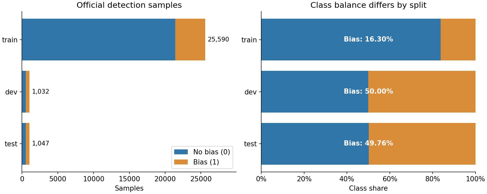
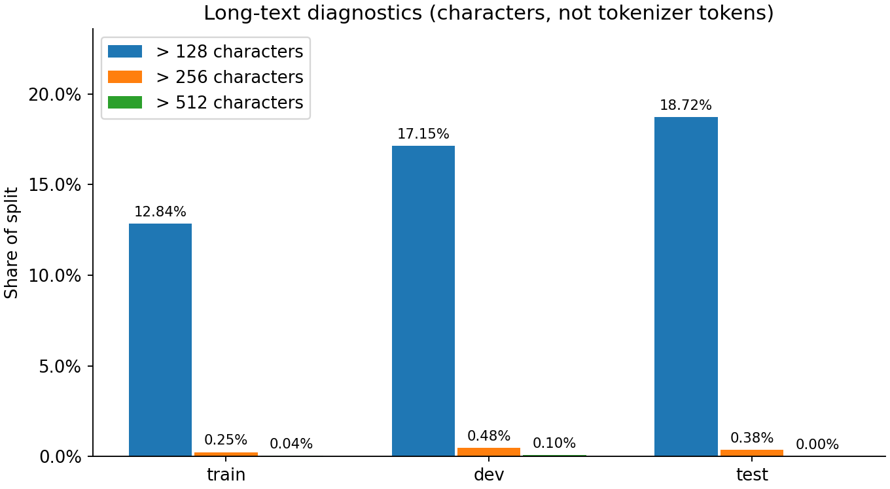

# P1 数据准备与质量审计

负责人：`yuge2018`。本部分交付锁定来源的下载校验、二分类数据转换、两种冻结版本、完整性验证、类别与长度统计、重复和标签冲突审计，以及其他成员可独立运行的接入入口。姓名/学号由本人填写。

## 数据来源与二分类构造

课程第8题为中文文本性别偏见检测，使用[CORGI-PM作者公开数据](https://github.com/yizhilll/CORGI-PM/tree/311a994e85a6111a268b1601a90097d741507c9a/dataset)。源提交固定为`311a994e85a6111a268b1601a90097d741507c9a`，读取两份npy之前分别核对文件字节数、SHA256和Git blob SHA1。来源与摘要见[初始锁定审计](../../configs/data/source_audit.json)和[本次处理摘要](../../configs/data/preparation_summary.json)。

按照作者检测入口，同split的偏见语料`ori_sentence`标为1，无偏见语料`text`标为0；不加入`edit_sentence`，也不把三个偏见类型的`bias_labels`向量当成二分类标签。源`valid`统一改名`dev`。原始Unicode文本逐字符保留，模型输入不做性别词删除、Unicode归一化或标点清洗。

检测的是句义中的性别偏见，不是是否提到女性。男性、女性、多目标角色规范及其他明确性别表达均属于任务解释范围；该数据没有目标对象的现成金标，因此本部分不能证明各性别对象的样本覆盖均衡。

## 样本与类别统计

| 划分 | 有偏见1 | 无偏见0 | 总数 | 有偏见比例 |
|---|---:|---:|---:|---:|
| train | 4,172 | 21,418 | 25,590 | 16.30% |
| dev | 516 | 516 | 1,032 | 50.00% |
| test | 521 | 526 | 1,047 | 49.76% |
| 合计 | 5,209 | 22,460 | 27,669 | — |

这里统计直接参与检测的原句。数据集概述中的32.9k与本题读取口径不同，不直接代替本次实测数量。train明显不平衡、dev/test接近均衡；P2/P3应只根据train统计类别权重，在dev上选参数与阈值，P4同时报告Macro-F1和阳性召回等指标。

## 长度检查

| 划分 | 空文本 | 中位字符数 | 平均字符数 | 最大字符数 | 超128字符 | 超256字符 | 超512字符 |
|---|---:|---:|---:|---:|---:|---:|---:|
| train | 0 | 37 | 59.15 | 1,090 | 3,285 | 63 | 9 |
| dev | 0 | 40 | 67.24 | 939 | 177 | 5 | 1 |
| test | 0 | 41 | 69.27 | 329 | 196 | 4 | 0 |

以上是Unicode字符长度，不是tokenizer token数。长度128可作为P3的起始资源配置，但实际截断率应由对应tokenizer另行统计，不能将这些比例直接称为模型截断率。

## 同文与标签冲突

train、dev、test内部重复文本的超额行数分别为265、1、4。该值是“行数减不同原始文本数”，不是重复组数。

| 跨划分关系 | 相同原始文本的不同字符串数 | 左侧匹配行数 | 右侧匹配行数 |
|---|---:|---:|---:|
| train / dev | 34 | 36 | 34 |
| train / test | 29 | 30 | 30 |
| dev / test | 2 | 2 | 2 |

相同原始文本出现相反0/1标签的组共11组：6组只在train内，3组跨train/dev，2组跨train/test。保留源金标与全部审计引用，不按模型输出或简单词典自动重标。P5可据此讨论标注语境与歧义；test标签不能为追求模型得分而更改。

归一化审计采用NFKC、casefold与去空白，只改变比较键，不修改模型输入。归一化后train内部重复超额行数为275，跨划分匹配及冲突组数量未增加。

## 词面近重复诊断

对归一化后至少30字符的18,140个不同文本，计算字符3gram集合。用固定seed42的32维MinHash和8×4 LSH寻找候选，再对候选计算精确Jaccard，阈值为0.85。

共检查63对候选，发现32对跨划分近重复文本。按关系计数为train/dev 7对、train/test 20对、dev/test 6对；同一文本对可能涉及多个划分，关系计数不能直接相加当独立文本对数。

这是词面、近似召回的诊断，不是穷举，也不能证明语义等价；短文本不进入此近重复搜索，但仍参与完整exact/normalized同文审计。详细结果保存在每个数据包的`audit/near_duplicates.jsonl`，以ID引用原文。

## 两个冻结版本与比较规则

主实验`corgi-official-v1`保持官方split和全部样本。补充版本`corgi-clean-train-v1`仅从train删除与dev/test精确同文的训练行，共65条，其中阳性44、阴性21；train剩25,525条，阳性4,128、阴性21,397。删除行号不重编号，dev/test输入与金标逐字节保持不变。

清理只使用held-out文本匹配，不读取其标签；它属于接触过held-out文本的敏感性分析，不能称为完全未见test的盲评。清理后train与dev/test的exact同文交集为0，但仍有词面近重复、6组train内部标签冲突及dev/test自身交叠；不把“clean”解释为已消除所有泄漏。

每个版本包含12个文件（含manifest）：标准数据、独立金标、ID映射、来源校验、质量报告、重复/近重复组和删除依据。模型只能使用text；ID和原始拼接顺序能够暴露类别，明确禁止作为特征。审计信息独立保存，不传入预测接口。

| 版本 | manifest SHA256 |
|---|---|
| official | `f78973f015839c13783c4a7fd3149ab7203c4ef1393845dc98d2b8e0ffbaf09a` |
| clean-train | `dccc6ec10f2db6b35ceaf782e3e17d2a14916bf10e3959ca9e660248fb1e3fec` |

## 验收与交接

在Python3.12.14、numpy2.3.5、matplotlib3.10.7环境运行真实下载、转换、审计及两包验证。之后使用已验证缓存离线独立重建，两个版本各12个文件的名称和SHA256全部一致；dev/test输入及金标跨版本逐字节一致。23项单元/契约测试通过，其中13项为P1新增；另外保留原6模块mock入口兼容。

完整代码入口为`python -m src.data prepare`和`python -m src.data verify`，接入说明见[数据模块说明](../../src/data/README.md)，证据见[验收记录](../../configs/data/acceptance.json)。数据本身不提交Git，成员运行锁定脚本即可得到相同文件；原文的性别对象覆盖和主观标签争议由P5进一步人工分析。

## 本人贡献与三分钟讲解

本人负责来源冻结与校验、格式转换、无标签推理接口、重复/冲突/近重复审计、清理版构建、统计图、验收测试与接入说明。P2/P3的模型训练、P4的正式评分和P5的对象人工标注不计入本部分成果。

讲解第1分钟：介绍二分类构造与27,669条直接检测样本，解释偏见子类向量和改写文本为何不进入主实验，说明任务不限于女性。

讲解第2分钟：展示16.30%的train阳性比例和同文交叠，说明11组标签冲突、32对词面近重复，以及为什么主版保留原划分而清理版另列。

讲解第3分钟：演示`verify`输出，展示两份manifest与两次构建一致的证据，说明dev/test金标隔离、ID不能作特征，以及数据缺少对象性别金标带来的覆盖分析限制。
