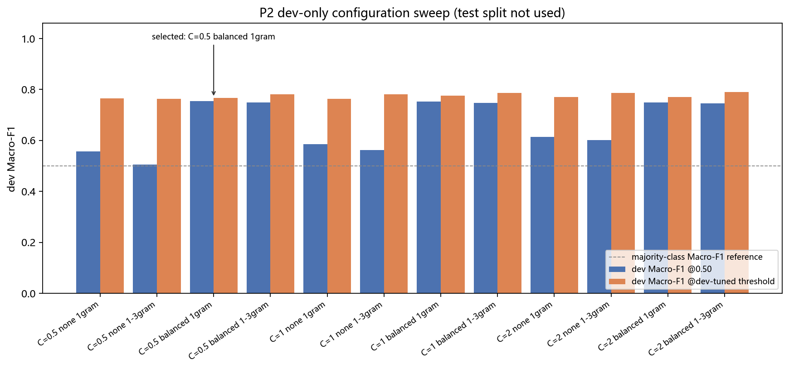
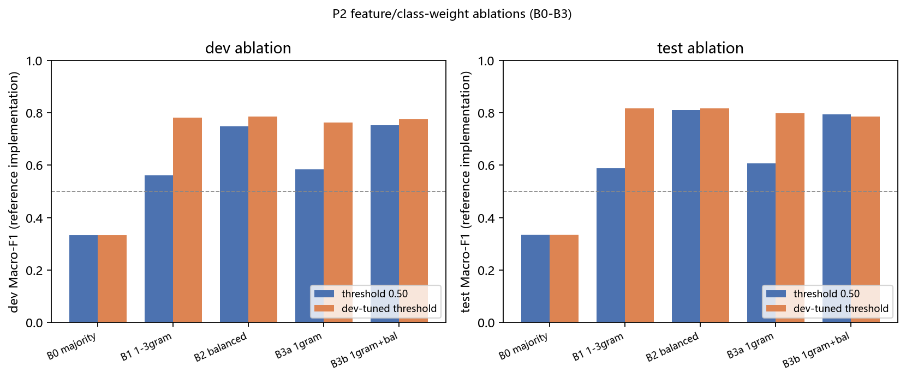
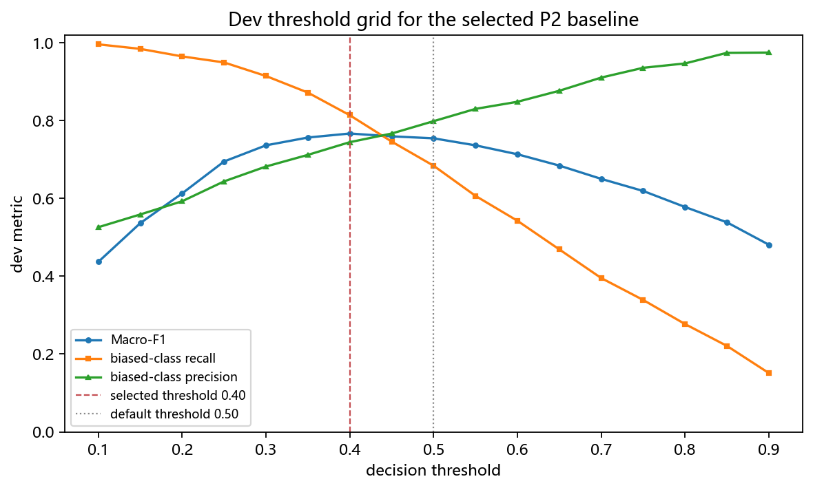
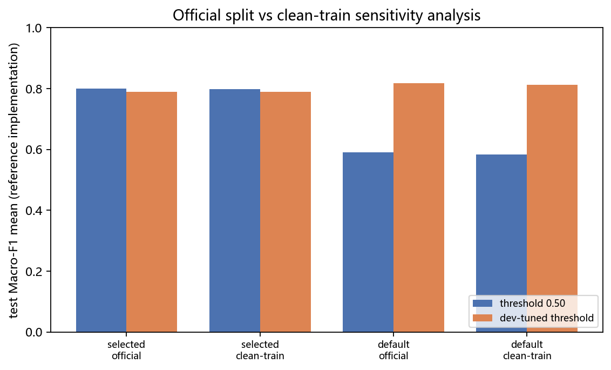
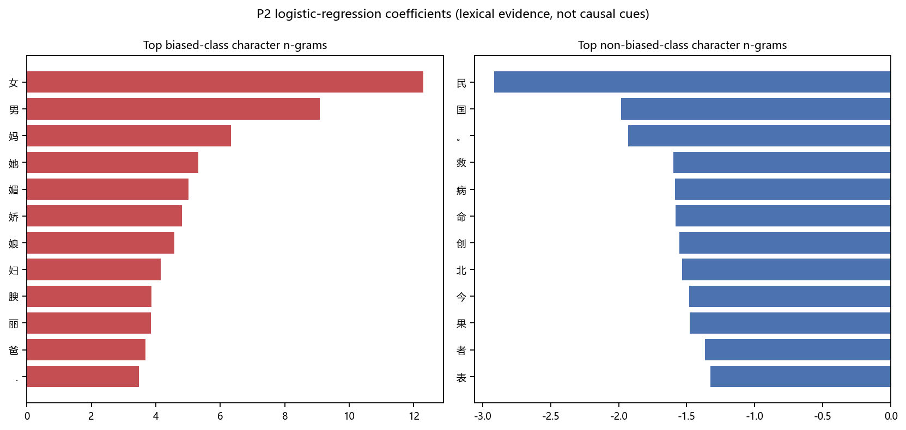

# P2 传统基线与特征消融

负责人：`cengjingdejiyi`（姓名/学号由本人填写）。分支：`part/p2-baseline`。

本部分交付字符 n-gram TF-IDF ＋ LogisticRegression 的 CPU 基线（B1）、多数类参照（B0）、类别加权与 n-gram 特征消融（B2/B3）、dev 上的配置与阈值选择、seed 42/43/44 的正式 run、清理训练集敏感性分析、离线适配器、测试、图表与验收证据。主指标为统一约定的 **Macro-F1（0/1 两类固定平均）**。

## 方法与依据

**只做文本二分类**：`0=无偏见`，`1=有偏见`。输入特征只有 `text`；ID、行号、源类别、`bias_labels`、`edit_sentence` 一律不进入模型。模型输出“label=1 的模型分数”，不是经过校准的“偏见概率”。

**数据隔离**：训练只打开 `train.jsonl`、`dev.jsonl` 与 `labels/dev.jsonl`；`test.jsonl` 只用于在配置、阈值、seed 全部冻结之后做推理；`labels/test.jsonl` 不参与任何选择。每个文件在读取前按 manifest 校验 SHA256 与行数，运行时记录 manifest 原始字节的 SHA256：

| 数据包 | train | dev | test | train 阳性率 | manifest SHA256 |
|---|---:|---:|---:|---:|---|
| `corgi-official-v1`（主实验） | 25,590 | 1,032 | 1,047 | 16.30% | `f78973f015839c13783c4a7fd3149ab7203c4ef1393845dc98d2b8e0ffbaf09a` |
| `corgi-clean-train-v1`（补充） | 25,525 | 1,032 | 1,047 | 16.17% | `dccc6ec10f2db6b35ceaf782e3e17d2a14916bf10e3959ca9e660248fb1e3fec` |

**模型**：`TfidfVectorizer(analyzer="char", ngram_range, max_features=100000, lowercase=False)` 只在 train 文本上 `fit`，再以 `LogisticRegression(C, class_weight, max_iter=1000, solver="liblinear", random_state=seed)` 拟合。`model_metadata.json` 记录 `vectorizer_fit_scope="train_only"` 与拟合行数；`predict` 会校验模型训练时的 manifest hash 与当前 manifest 一致，拒绝跨数据版本混用。

**选择规则（在 test 之前冻结）**：dev 上比较 `C∈{0.5,1,2}` × `class_weight∈{null,balanced}` × `ngram_range∈{[1,1],[1,3]}` 共 12 个变体，以 dev Macro-F1（默认阈值 0.5）选配置；并列时依次偏好无类别加权、更窄 n-gram、更小 C。阈值在同一 dev 网格 `0.10–0.90`（步长 0.05）单独选择，并列规则为最接近 0.5、再取较小阈值。最终配置 `configs/baseline/selected.json` 为字符 1-gram + `class_weight="balanced"` + `C=0.5`，dev 选中阈值 0.40；正式 test 同时报告默认 0.50 与 dev 选中阈值两个 run。

**不平衡与类别加权**：train 仅 16.30% 为阳性，不加权时模型退化为“高精度、低召回”；`class_weight="balanced"` 只使用 train 统计改变两类损失权重，不读取 dev/test 标签。

## 配置与运行证据

运行环境（`configs/baseline/acceptance.json` → `environment`）：Windows 11（AMD64，CPU）、Python 3.12.14、numpy 2.3.5、scipy 1.18.1、scikit-learn 1.9.1、joblib 1.6.0、matplotlib 3.10.7；依赖锁在 [`requirements/p2.txt`](../../requirements/p2.txt)。无 GPU 依赖。

代码提交：`1efea2b810d4a898cba92c28360b559e88b35800`（实验运行时代码树干净，`code_dirty=false`）。所有 run 的 `run_metadata.json` 记录 `dataset_manifest_sha256`、`seed`、`threshold`、`code_commit`、`model_name`、`model_revision`、`config` 与 `environment`。

```sh
# 复现整个实验矩阵（2 个数据版本 × dev 扫描 + 3 seeds + B0–B3 消融 + 验收 JSON + 图表）
python -m src.baseline experiments --data-dir data/processed --output-dir runs/p2 --artifacts-dir artifacts/p2 --configs-dir configs/baseline --figures-dir reports/figures/P2
# 只做 dev 扫描（不读 test）
python -m src.baseline sweep --data-dir data/processed/corgi-official-v1 --config configs/baseline/sweep.json --output-dir runs/p2/corgi-official-v1/sweep
# 单元/契约测试
python -m unittest discover -s tests -v
```

本次共产生 64 个 run（`runs/p2/<dataset>/<tag>-s<seed>-<split>[-tuned]`）、模型目录 `artifacts/p2/<dataset>/<tag>-s<seed>`。完整机器可读证据见 [`configs/baseline/acceptance.json`](../../configs/baseline/acceptance.json)（数据与 manifest hash、12 变体 dev 扫描、每次 run 的参考指标、seed 汇总、消融、清理敏感性、LR 权重、环境与局限）。其中指标由冻结参考实现 `src/common/contracts.binary_metrics` 计算，仅作 P2 自查；**P4 必须从 run 目录重算正式指标**，本模块不写 `metrics.json`。

## 实验结果

### 1. dev-only 配置扫描（12 个变体，official）

| C | class_weight | n-gram | dev Macro-F1@0.50 | dev Acc | 阳性 Recall | 阳性 Precision | dev 选中阈值 | 选中阈值 dev Macro-F1 | 训练+dev 评分用时 |
|---:|---|---:|---:|---:|---:|---:|---:|---:|---:|
| 0.5 | balanced | 1 | **0.7546** | 0.7558 | 0.6841 | 0.7986 | 0.40 | 0.7669 | 0.7 s |
| 1.0 | balanced | 1 | 0.7523 | 0.7539 | 0.6744 | 0.8018 | 0.40 | 0.7751 | 0.8 s |
| 2.0 | balanced | 1 | 0.7492 | 0.7510 | 0.6667 | 0.8019 | 0.35 | 0.7699 | 1.0 s |
| 0.5 | balanced | 1–3 | 0.7484 | 0.7510 | 0.6492 | 0.8151 | 0.40 | 0.7805 | 6.9 s |
| 1.0 | balanced | 1–3 | 0.7478 | 0.7510 | 0.6395 | 0.8229 | 0.40 | 0.7859 | 7.2 s |
| 2.0 | balanced | 1–3 | 0.7456 | 0.7500 | 0.6182 | 0.8395 | 0.35 | 0.7897 | 8.8 s |
| 2.0 | null | 1 | 0.6133 | 0.6541 | 0.3295 | 0.9392 | 0.15 | 0.7713 | 0.7 s |
| 2.0 | null | 1–3 | 0.6016 | 0.6483 | 0.3062 | 0.9693 | 0.15 | 0.7868 | 7.4 s |
| 1.0 | null | 1 | 0.5852 | 0.6357 | 0.2868 | 0.9487 | 0.15 | 0.7636 | 0.8 s |
| 1.0 | null | 1–3（B1） | 0.5621 | 0.6231 | 0.2500 | 0.9847 | 0.15 | 0.7817 | 7.0 s |
| 0.5 | null | 1 | 0.5561 | 0.6172 | 0.2461 | 0.9549 | 0.15 | 0.7654 | 1.9 s |
| 0.5 | null | 1–3 | 0.5060 | 0.5882 | 0.1802 | 0.9789 | 0.15 | 0.7637 | 6.8 s |



**读法**：类别加权在默认阈值 0.5 下把 Macro-F1 从 0.50–0.61 提升到 0.75 左右，主要来自阳性召回从 0.18–0.33 提升到 0.62–0.68，代价是阳性精度从 0.94–0.98 降到 0.80 左右。1-gram 变体在 dev@0.5 上略优于 1–3gram（0.7546 vs 0.7478），但 1–3gram 在 dev 调阈值后更高（0.7859 vs 0.7751），说明特征粒度与阈值存在交互；这一点在 test 上又有不同表现，见第 4、5 节。选择规则只看默认阈值 0.5，因此选中 C=0.5、balanced、1-gram。

### 2. 主基线（选中配置）正式结果

三个 seed 的正式 run（official 与 clean）：

| 数据集 | 阈值 | n | Macro-F1（均值±样本标准差） | 阳性 P | 阳性 R | 阳性 F1 | 负类 F1 | Accuracy |
|---|---|---:|---|---:|---:|---:|---:|---:|
| official | 0.50 | 1,047 | **0.8001 ± 0.0000** | 0.8223 | 0.7639 | 0.7920 | 0.8081 | 0.8004 |
| official | 0.40（dev 选中） | 1,047 | 0.7891 ± 0.0000 | 0.7547 | 0.8560 | 0.8020 | 0.7760 | 0.7899 |
| clean-train | 0.50 | 1,047 | 0.7972 ± 0.0000 | 0.8186 | 0.7620 | 0.7890 | 0.8051 | 0.7975 |
| clean-train | 0.40（dev 选中） | 1,047 | 0.7892 ± 0.0000 | 0.7564 | 0.8522 | 0.8023 | 0.7769 | 0.7899 |

seed 42/43/44 的三个 run 指标逐位相同（标准差 0.0000）。这是逻辑回归凸优化 + 固定数据顺序 + 同一 dev 阈值选择带来的确定性结果，不是“只跑了一次”；但也不能把它当作“多 seed 稳定”的证据——本方法本身没有随机性，seed 只影响保存的元信息。报告如实披露为标准差 0，不虚构波动。

### 3. B0–B3 消融（official，seed 42）

| 变体 | 配置 | dev Macro-F1@0.50 | dev Macro-F1@dev 阈值 | test Macro-F1@0.50 | test Macro-F1@dev 阈值 | test 阳性 R@0.50 | 训练用时 | vocab |
|---|---|---:|---:|---:|---:|---:|---:|---:|
| B0 | 多数类恒 0（参照） | 0.3333 | 0.3333 | 0.3344 | 0.3344 | 0.0000 | <0.01 s | 0 |
| B1 | 1–3gram，无加权，C=1 | 0.5621 | 0.7817 | 0.5896 | **0.8178** | 0.2841 | 7.4 s | 100,000 |
| B2 | 1–3gram，balanced，C=1 | 0.7478 | 0.7859 | 0.8106 | 0.8175 | 0.7332 | 7.3 s | 100,000 |
| B3a | 1gram，无加权，C=1 | 0.5852 | 0.7636 | 0.6082 | 0.7974 | 0.3129 | 1.2 s | 5,288 |
| B3b | 1gram，balanced，C=1 | 0.7523 | 0.7751 | 0.7949 | 0.7858 | 0.7409 | 1.0 s | 5,288 |



**结论**：(1) B0 的 Accuracy 在均衡 test 上只有 0.5024，Macro-F1 0.3344，说明“全预测多数类”在均衡评测下毫无价值；(2) 类别加权（B1→B2）显著提升 dev/test Macro-F1（B1@0.5 test 0.5896 → B2@0.5 test 0.8106）；(3) 1-gram（B3a/B3b）在 1/3 的特征数、约 1/7 的训练时间下与 1–3gram 接近（B3b test@0.5 0.7949 vs B2 0.8106），是可接受的轻量替代；(4) dev 调阈值对 B1/B2/B3a 有提升，但对 B3b 反而下降，说明阈值收益不稳定。

### 4. 阈值选择（T1）与“dev 不保证 test”

选中配置（字符 1-gram、balanced、C=0.5）的 dev 阈值曲线：



dev 最优阈值 0.40（Macro-F1 0.7546 → 0.7669，阳性召回 0.6841 → 0.8140），但同一阈值在 official test 上 Macro-F1 从 0.8001 降到 0.7891（阳性召回 0.7639 → 0.8560，阳性精度 0.8223 → 0.7547）。即 dev 网格上的小收益没有迁移到 test，属于典型的开发集-测试集波动；主比较建议使用默认 0.50，调阈值结果作为 T1 补充如实保留，不能只挑 test 更高的那个阈值。

类似地，dev@0.5 排名第一的选中配置在 test@0.5 上为 0.8001，低于消融中 B2 的 0.8106 和 B1@dev 阈值的 0.8178。差异约 1–1.8 个 Macro-F1 百分点，在 1,047 条 test 上的波动范围内；这提醒 P4/报告不要在 test 上回头重选配置，主表应固定 dev 选择结果并同时呈现不确定性。

### 5. 清理训练集敏感性（L1）

`corgi-clean-train-v1` 只删除 train 中与 dev/test 精确同文的 65 行（44 正、21 负），dev/test 输入与金标逐字节不变。沿同一配置在 clean 版重训：

| 配置 | official test Macro-F1@0.50 | clean test Macro-F1@0.50 | Δ | official test Macro-F1@dev 阈值 | clean test Macro-F1@dev 阈值 | Δ |
|---|---:|---:|---:|---:|---:|---:|
| 选中配置（seed 均值） | 0.8001 | 0.7972 | −0.0029 | 0.7891 | 0.7892 | +0.0001 |
| B1（1–3gram 无加权） | 0.5896 | 0.5824 | −0.0072 | 0.8178 | 0.8130 | −0.0048 |



删除已知同文对结果影响很小（≤0.007 Macro-F1）。这不代表数据没有泄漏风险：clean 版仍存在词面近重复、train 内标签冲突与 dev/test 自身交叠（P1 审计），且该版本使用过 held-out 文本做匹配，属于敏感性分析而非未见测试盲评。两个版本不能混入同一张主表。

### 6. 特征解释与“性别词捷径”风险

选中 1-gram 模型的最高权重特征（`configs/baseline/acceptance.json` → `top_features`）：

| 方向 | 字符（权重） |
|---|---|
| 有偏见 | 女(12.30) 男(9.09) 妈(6.34) 她(5.32) 媚(5.01) 娇(4.81) 娘(4.58) 妇(4.15) 腴(3.86) 丽(3.85) 爸(3.69) 姑(3.40) 柔(3.17) 美(2.97) 温(2.84) 婉(2.79) |
| 无偏见 | 民(−2.91) 国(−1.98) 。(−1.93) 救(−1.60) 病(−1.58) 命(−1.58) 创(−1.55) 北(−1.53) 今(−1.48) 果(−1.48) 者(−1.37) 表(−1.33) 车(−1.22) |

B1（1–3gram）模型的部分正权重 n-gram 为 `女(13.36)`、`男(8.24)`、`男人(5.63)`、`女人(5.06)`、`妈妈(3.44)`、`的女(3.50)`；负权重有 `民(−2.40)`、`国(−1.80)`、`女儿(−1.63)`、`病(−1.54)`、`救(−1.30)`、`创(−1.18)`。



这组权重暴露两个问题：(1) 模型确实把“性别词出现”当作强信号，而 P1 明确说明出现“男/女/他/她”不等于有偏见，说明字符特征利用的是词面相关性而非充分语义；(2) 负权重集中在 `民/国/病/救/创/者` 等新闻、医疗、议论类词面，提示正负类语料可能存在来源/文体差异，Macro-F1 的一部分可能来自“语料风格”而非“偏见语义”的区分。P5 的分组与错误分析应专门检验这一混杂；本部分只如实报告词面权重，不把 LR 权重当作因果偏见线索。

### 7. 错误类型示例（选中配置 seed 42，official test）

默认阈值 0.5 下 test 混淆矩阵为 `[[440, 86], [123, 398]]`（FP=86，FN=123）；dev 选中阈值 0.4 下为 `[[381, 145], [75, 446]]`（FP=145，FN=75）。把阈值从 0.5 降到 0.4 只是把约 50 个错误从漏报改成误报，Macro-F1 没有提升。

| 类型 | 参考分数 | 文本（截断） | 观察 |
|---|---:|---|---|
| FP | 0.727 | 詹大胖子是个大胖子。很胖，而且很白……露出胸脯和肚子 | 人物外貌/身体描写被判为偏见，缺少实际贬损语境 |
| FP | 0.699 | 远处走过来一个穿长衫的瘦长男人。 | 含“男人”的中性叙述被判阳性，符合“性别词捷径” |
| FP | 0.479 | 这位来自黑龙江的患者是一名50多岁的女性，患有恶性青光眼…… | 含“女性”的医疗叙述被判阳性 |
| FN | 0.418 | 他，齐虹……在那执拗的江玫面前…… | 文学化、隐含性别权力关系的文本，词面特征难以捕获 |
| FN | 0.396 | 她那薄而小巧的嘴角，正带著个矜持而若有所思的微笑。 | 外貌/角色规训的隐含描写，字符特征无法识别 |
| FN | 0.230 | 她讲起话来，总是尖声尖气，扭扭捏捏。 | 明显的性别刻板印象，模型因缺少局部词面信号而漏报 |

这些例子说明：字符 TF-IDF + LR 适合作为可解释、低成本的参照基线，但不是可靠的偏见检测器；对隐含、文学化与否定/引用语境需要 P3 的语义模型与 P5 的人工分析补充。

## 运行耗时与资源

| 项目 | 数值 |
|---|---|
| 完整实验矩阵（2 数据版本、12 变体 dev 扫描 ×2、22 次模型拟合、64 个 run 含 32 次 dev/test 预测、验收 JSON、10 张图） | 184 s（单机 CPU，无 GPU） |
| 选中配置训练 + dev 评分 | 0.85 s |
| B1（100,000 维 1–3gram）训练 + dev 评分 | 7.4 s |
| 选中模型产物（`model.joblib` + 元信息） | 0.22 MB |
| B1 模型产物 | 4.31 MB |

推理无批量打乱：`predict_proba` 按输入顺序分批计算，单元测试验证 full-batch 与逐条预测逐位相等；预测行与输入行一一对应。

## 验收证据与复现

- [x] 同一保存模型离线加载（`load_predictor(model_dir)`），batch 与单条预测一致；空列表返回 `[]`，空文本抛 `ValueError`，缺失模型目录抛 `FileNotFoundError`。
- [x] 输出 label=1 分数、ID/顺序与阈值正确；`predict` 输入含 `label` 或额外字段时返回码 2 且不生成 run。
- [x] 保存 train-only 拟合证据（`vectorizer_fit_scope`、拟合行数与 vocab）、完整配置与可追溯 run（manifest hash、code commit、environment）。
- [x] 至少一份真实基线结果：official test @0.5 Macro-F1 0.8001、Accuracy 0.8004；另有 dev 扫描、B0–B3、seed 与 clean 敏感性。
- [x] 报告片段、5 组图表、验收 JSON、贡献记录与三分钟讲解已提交。

测试：仓库 `python -m unittest discover -s tests -v` 共 43 项通过，其中 20 项为 P2 新增（配置校验、train-only 向量器、ID 无关性、推理拒绝标签、阈值规则、batch 一致性、适配器、B0、sweep、版本一致、mock 标记与旧 `--mock` 入口兼容）。CI 仍需在无 scikit-learn 的解释器上通过契约与 mock 检查，因此依赖 scikit-learn 的测试用 `skipUnless` 跳过。

复现顺序（新目录）：安装 `requirements/p2.txt` → 按 P1 接入说明生成两个数据包 → `python -m src.baseline experiments ...`。模型、预测、日志与验收 JSON 均可用该命令重建；预测文件不提交 Git，由 P4 按 run 目录读取或按命令重建。

## 局限与待办

1. 字符 n-gram 无法可靠表示否定、引用反驳、语序与上下文；错误示例中隐含刻板印象漏报明显。
2. 正负类语料的来源/文体差异可能被词面特征利用（负权重多为新闻/医疗词面），分组与混淆分析需 P5 检验；不能把高 Macro-F1 直接解释为“识别偏见的能力强”。
3. dev 选择与 test 表现存在约 1–2 个百分点波动，dev 阈值 0.40 在 test 上反而降低 Macro-F1；主表用默认 0.50，调阈值结果单列。
4. 逻辑回归在此设置下种子间结果完全一致，零方差是方法性质；它不提供“跨 seed 稳健性”证据。
5. 官方 split 存在精确同文与近重复；clean 版敏感性只覆盖精确同文，不能称为完全无泄漏。
6. 分数未校准，不能解释为客观偏见概率；没有目标性别金标，本部分不做分组公平性结论。
7. 正式 `metrics.json`、`comparison.csv` 与主表由 P4 从 run 目录统一生成；`acceptance.json` 中的数字是 P2 自查参考值，不能替代 P4 复核。

## 答辩准备

**为什么选字符特征？** 中文分词会引入分词器误差，字符 1–3gram 无需分词器、对错别字与网络用语更稳、CPU 训练只需秒级，并且权重可直接回溯到具体字符；本实验也显示 1-gram 在 1/3 维度下接近 1–3gram，是低成本参照基线。代价是字符特征只有词面相关性，无法处理上下文、否定与引用。

**类别加权影响什么？** `class_weight="balanced"` 只按 train 的两类频次调整损失权重（正类约 5.13 倍），提高阳性召回而降低阳性精度：不加权 B1@0.5 test 阳性召回 0.2841、精度 0.9933、Macro-F1 0.5896；加权 B2@0.5 test 阳性召回 0.7332、精度 0.8682、Macro-F1 0.8106。它不会凭空增加信息，也不保证 test 提升，只是移动决策代价。

**高 Accuracy 是否说明能识别偏见？** 不能。B0 在 train 分布上“全预测无偏见”就有 83.7% Accuracy，但 Macro-F1 约 0.33；B1 默认阈值 Accuracy 0.6428 时阳性召回只有 0.2841，大量偏见句被漏掉。本项目因此以 Macro-F1 为主指标，并始终同时报告阳性/阴性 F1、召回、精度、混淆矩阵与样本数。

## 本人贡献与三分钟讲解

本人负责：P2 模块结构、数据/契约隔离、字符 TF-IDF + LR 实现、B0–B3 与 dev 配置扫描、阈值选择、seed 与 clean 敏感性 run、离线适配器、20 项测试、验收 JSON、5 组图表与本节方法/结果写作；不包含 P1 数据准备、P3 语义模型、P4 正式评分与 P5 对象标注。

**第 1 分钟**：说明二分类构造、只使用 text、manifest hash 与 train/dev/test 隔离，以及为什么主指标用 Macro-F1（train 16.3% 阳性、B0 在类别比例偏斜下 Accuracy 很高但 Macro-F1 约 0.33 的陷阱）。

**第 2 分钟**：展示 dev 12 变体扫描与选择规则，解释类别加权把阳性召回从 0.28 提到 0.73，说明 1-gram 与 1–3gram 的精度/召回取舍，以及选中配置（1-gram、balanced、C=0.5、dev 阈值 0.40）。

**第 3 分钟**：展示 official test 主结果（0.5 阈值 Macro-F1 0.8001、阳性召回 0.7639）、调阈值反而降分的 dev/test 波动、clean 敏感性（−0.003），并用 `女/男/妈/她` 与 `民/国/病/救` 的权重说明“性别词与语料风格捷径”的风险及 P3/P5 的后续工作。
