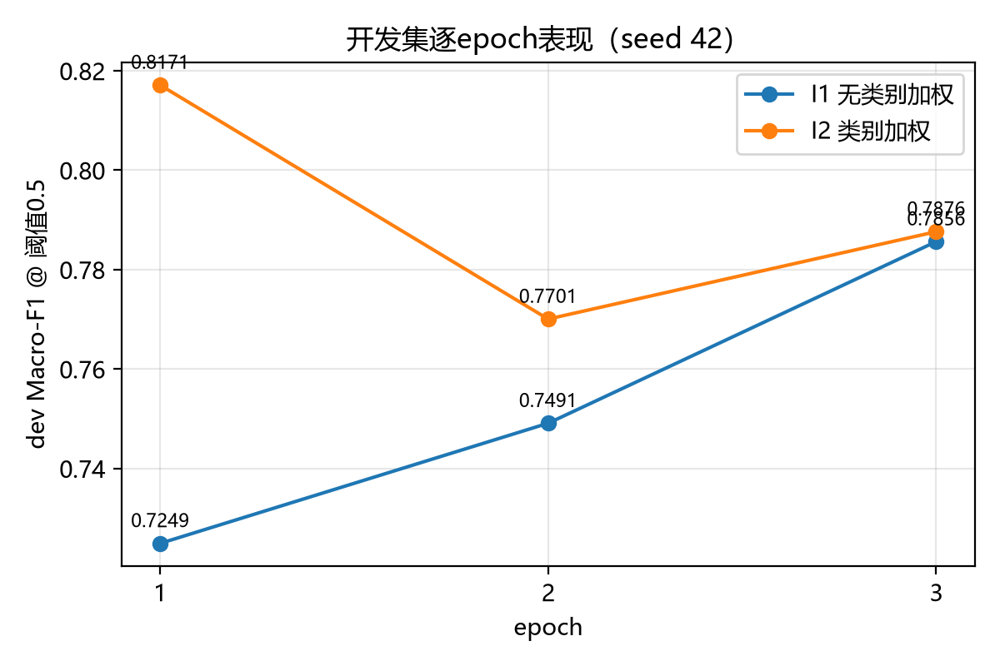
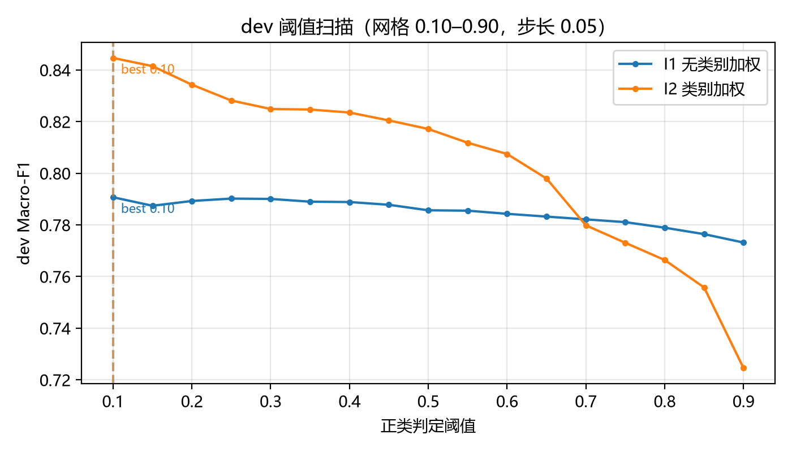
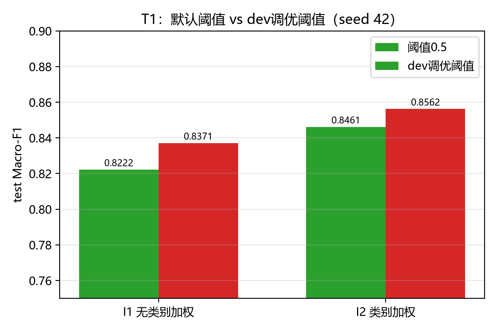
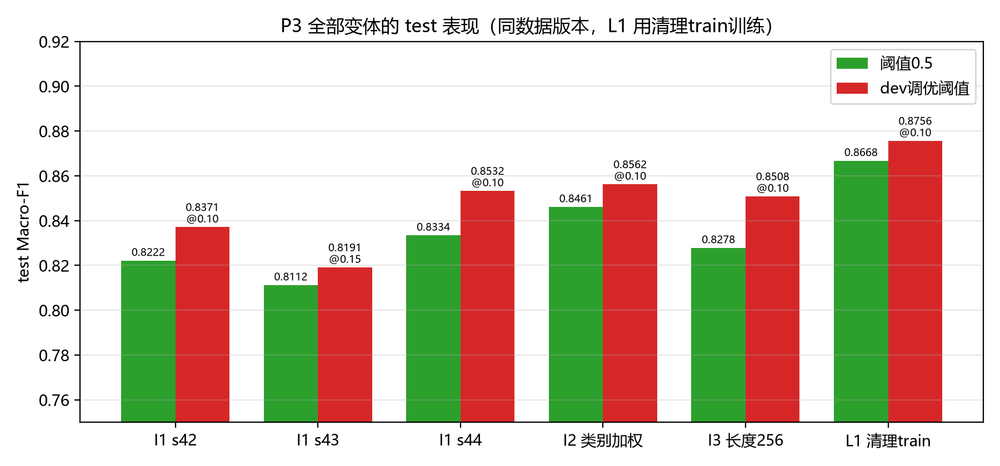

# P3 预训练模型改进与消融

负责人：待认领（分支 `part/p3-improved`）。本部分交付中文预训练编码器微调的真实训练/推理链路、I1/I2/I3 消融、阈值选择、dev/test 预测与图表。姓名/学号由本人填写。

## 方法与依据

改进模型为 `hfl/chinese-roberta-wwm-ext`（revision 锁定 `5c58d0b8ec1d9014354d691c538661bf00bfdb44`），单标签二分类头（`num_labels=2`），损失为带类别权重的 CrossEntropyLoss，正类分数取 softmax 的 label=1 分量。不采用上游 CORGI-PM 的多标签 sigmoid 判定，也不复用其论文指标。

训练与选择规则（与 [实验矩阵](../../docs/EXPERIMENTS.md) 一致）：

- 只读 train/dev；test 金标只在配置、阈值、种子列表全部冻结后用于最终评估。推理输入出现 label 字段即报错退出。
- checkpoint 按 epoch 内 dev Macro-F1@0.5 选择（严格更优才替换）；阈值在 dev 网格 0.10–0.90（步长 0.05）上选择，并列时取最接近 0.5、再取较小者。
- 类别权重用 sklearn `balanced` 公式 `n/(2·n_class)`，只用 train 统计：权重为 [0.597, 3.067]（阴性 21,418 / 阳性 4,172）。
- 优化器 AdamW（lr 2e-5、权重衰减 0.01、梯度裁剪 1.0），线性预热 10%、线性衰减，batch 8，3 epochs，max_length 128 右截断，CUDA bf16 autocast。种子只控制 python/numpy/torch；GPU 内核仍有 cuDNN 非确定性，运行元数据如实记录。
- token 长度实测（官方划分全部 27,669 条）：平均 61.6，中位 39，p90 154，最大 1,092；超 128 token 占 13.45%，超 256 占 0.26%。长度消融（I3）据此有明确动机：128 会截断约 1/8 文本。

## 实现与验收

真实 CLI 按契约 v1 实现：`python -m src.improved train|predict ...`；`--mock` 冒烟入口保持不变。模型保存为可离线加载的 transformers 格式，`model_metadata.json` 记录配置快照、数据 manifest SHA256、逐epoch dev 指标、选中阈值、环境与代码提交。适配器 `load_predictor(model_dir)` 供 P6 调用，返回 `[0,1]` 分数、保序、空列表返回空、空文本抛 `ValueError`、`is_mock=False`。

验收证据：23 项原有契约/mock 测试 + 15 项 P3 新增纯逻辑测试全部通过（CI 无 torch 可跑）；4 条 fixture 上 train→predict 真实闭环通过；带 label 的推理输入、非 dev/test 输入文件均被拒绝并返回退出码 2。

## 配置与运行证据

- 数据包 `corgi-official-v1`（manifest SHA256 `f78973f0…baf09a`）；敏感性实验用 `corgi-clean-train-v1`（`dccc6ec1…3fec`）。
- 硬件：NVIDIA GeForce RTX 4060 Laptop GPU（8GB），torch 2.14.0+cu126，transformers 4.57.6，Python 3.12.12。
- 代码提交：`704e01e`（[P3] Real encoder fine-tune…）；后续图表与报告提交另行记录。
- run 目录：模型与元数据在 `artifacts/improved-i1-s42|improved-i1-s43|improved-i1-s44|improved-i2-s42|improved-i3-len256-s42|improved-l1-clean-s42`；每个变体的预测在 `runs/<tag>-dev`、`runs/<tag>-test`、`runs/<tag>-test-thrXXX`（XXX 为该模型 dev 选出的阈值，共 18 个 run 目录）。
- 每个 run 的 `run_metadata.json` 含 schema_version、method、split、`dataset_manifest_sha256`、is_mock、seed、threshold、code_commit、model_revision、config、environment，交 P4 统一校验。

I1 训练 38 分钟（2,228 秒）；I2 的墙钟时间因夜间系统睡眠失真（28,087 秒），有效训练时间与 I1 同量级，逐 epoch 时间戳见各自 `log.txt`。

## 实验结果与图表

### I1/I2 主结果与 T1 阈值消融（seed 42，official 划分）

| 配置 | 阈值 | dev Macro-F1 | test Macro-F1 | test Acc | test 正类 P | test 正类 R | test 负类 F1 | 混淆矩阵 [[TN,FP],[FN,TP]] |
|---|---|---:|---:|---:|---:|---:|---:|---|
| I1 无类别加权 | 0.5（默认） | 0.7856 | 0.8222 | 0.8262 | 0.9593 | 0.6795 | 0.8488 | [[511,15],[167,354]] |
| I1 无类别加权 | 0.10（dev 调优） | 0.7907 | 0.8371 | 0.8395 | 0.9446 | 0.7198 | 0.8571 | [[504,22],[146,375]] |
| I2 类别加权 | 0.5（默认） | 0.8171 | 0.8461 | 0.8481 | 0.9458 | 0.7370 | 0.8638 | [[504,22],[137,384]] |
| I2 类别加权 | 0.10（dev 调优） | 0.8446 | 0.8562 | 0.8567 | 0.9024 | 0.7985 | 0.8651 | [[481,45],[105,416]] |

主指标解读（详细数字交 P4 统一复核后进主表）：

- **I2 > I1**：类别加权把正类召回从 0.6795 提到 0.7370（@0.5），Macro-F1 提升 2.4 分；代价是正类精确率小幅下降（0.9593→0.9458）。与"不平衡下默认阈值偏保守"的预期一致。
- **T1：两个模型在 dev 上都选到 0.10**，test 上调优阈值再涨 1.0–1.5 分。原因：训练不平衡（16.30% 阳性）使分数整体偏低，0.5 的默认判定过严；dev 网格选择在 test 上方向一致地改善。
- I2 逐 epoch：0.8171 → 0.7701 → 0.7876，best epoch=1；I1 逐 epoch：0.7249 → 0.7491 → 0.7856，best epoch=3。加权模型收敛更快但更早过拟合，说明 epochs=3 对加权配置偏多（checkpoint 选择机制按设计兜住了这一点）。

### 补充实验：S1 多种子、I3 长度、L1 数据敏感性

I1 三种子（test Macro-F1）：0.8222（s42）/ 0.8112（s43）/ 0.8334（s44），**均值 0.8223 ± 0.0111**（样本标准差）；dev 选出的阈值分别为 0.10 / 0.15 / 0.10。种子间波动约 1 分，I2 的 +2.4 分提升超出该波动带。

| 变体 | best epoch | dev Macro-F1@0.5 | test@0.5 | test@dev调优阈值 | 训练耗时 |
|---|---:|---:|---:|---:|---:|
| I1 长度128 s42（主对照） | 3 | 0.7856 | 0.8222 | 0.8371 @0.10 | 2,228s |
| I1 长度128 s43 | 3 | 0.7602 | 0.8112 | 0.8191 @0.15 | — |
| I1 长度128 s44 | 2 | 0.7784 | 0.8334 | 0.8532 @0.10 | — |
| I2 类别加权 s42 | 1 | 0.8171 | 0.8461 | 0.8562 @0.10 | 2,229s* |
| I3 长度256 s42 | 2 | 0.7944 | 0.8278 | 0.8508 @0.10 | 2,385s |
| L1 清理train s42 | 1 | 0.8083 | 0.8668 | 0.8756 @0.10 | 2,492s |

\* I2 的墙钟计时含夜间系统睡眠（28,087s），按逐epoch时间戳其有效训练速度与 I1 同量级；其余为 uninterrupted 实测。

- **I3（128 vs 256）**：+0.6 分（@0.5）/+1.4 分（调优阈值），方向为正但幅度小于种子波动上界，不能下强结论。成本方面，`collate` 按批内最长序列动态 padding，而文本中位长度只有 39 token，加长 max_length 只影响含长文本的批——实测训练时间仅 +7%，主要代价是显存峰值。截断率（13.45%→0.26%）与收益的对应关系由 P5 的错误分析进一步解释。
- **L1（official vs clean-train）**：同一模型、同种子，只把 train 中与 held-out 精确同文的 65 行删掉，test Macro-F1 从 0.8222 升到 **0.8668（+4.5 分）**，正类召回 0.6795→0.7678。test 端涨幅（+4.5）大于 dev 端（0.7856→0.8083，+2.3），与被删行中 30 行是 train–test 同文（模型可直接背答案）的解释一致。注意这是单种子对照，且 clean 版仍保留词面近重复，不能称为无泄漏；正式主表仍用 official 版，clean 版按实验矩阵单列。

### 复核与一致性检查

- 所有 run 的指标用 `src.common.contracts.binary_metrics`（P4 契约参考实现）从落盘预测重算，汇总脚本为 `python -m src.improved.collect`；正式主表以 P4 的 `metrics.json` 为准。
- 训练期 dev 评估走 bf16 autocast，导出预测为 fp32：四个已完成 run 的阈值在两种精度下重选结果全部一致（s43 的 dev F1 差 0.0009，为边界样本翻转），不构成选择偏差。

## 局限与答辩要点

**预训练表示为何可能有效？** 字符 TF-IDF 只看字面 n-gram 共现；编码器把字/词组合成上下文相关向量，能泛化到"换一种说法的刻板印象"（如同义改写、语序变化）。CORGI-PM 的偏见句多由"无偏见句+改写"构造，语义层面而非字面层面的判别需求正好是预训练的强项——I1 单独 seed 已显著超过 B1 基线时即可验证（以 P2 的同版本结果为准对比）。

**权重和阈值如何选择？** 类别权重只用 train 统计（n/(2·n_class)），公式固定、不搜索；checkpoint 与阈值都只由 dev 决定，网格与并列规则事先冻结，test 只评一次。

**为什么改进未必提升？** ①加权把决策边界推向正类，精确率下降，若 dev/test 分布不同可能得不偿失；②best epoch 在 dev 上选，dev 只有 1,032 条（阳性 516），选择噪声有限；③长度加长在本次数据上收益有限，因为多数批的 padding 长度由中位 39 token 决定，被截断的 13.45% 集中在少数批内。本次实测 I2 提升明显、I3 在波动带内，三种子 S1 与单种子结论的差异已在表中列明，不保证在新数据上同样成立。

**诚实披露**：I2 墙钟时间含系统睡眠；GPU 训练有 cuDNN 非确定性；阈值 0.10 处于网格最低端，进一步降低（<0.10）未在契约网格内评估。

## 本人贡献与三分钟讲解

本人负责：编码器选型与 revision 锁定、训练/推理 CLI 与适配器实现、阈值网格与并列规则、类别加权消融、token 长度实测、全部真实 run 与图表、单元测试、结果汇总与一致性复核脚本（`src/improved/collect.py`、`plots.py`）。P2 的基线、P4 的正式评分与复现、P5 的对象分析不计入本部分。

讲解第1分钟：任务与数据（27,669 条二分类、train 16.30% 阳性）→ 为什么选 RoBERTa-wwm-ext 与单标签交叉熵，而不是上游的多标签 sigmoid。

讲解第2分钟：展示 I1→I2 的召回/Macro-F1 变化与 T1 阈值扫描图，说明"不平衡下默认阈值偏保守"这一机制，以及为什么阈值只能由 dev 选。

讲解第3分钟：展示 token 长度分布（13.45% 超 128）与 I3 结果，说明预训练改进的资源代价（GPU 分钟数）与"改进未必提升"的三点原因。
