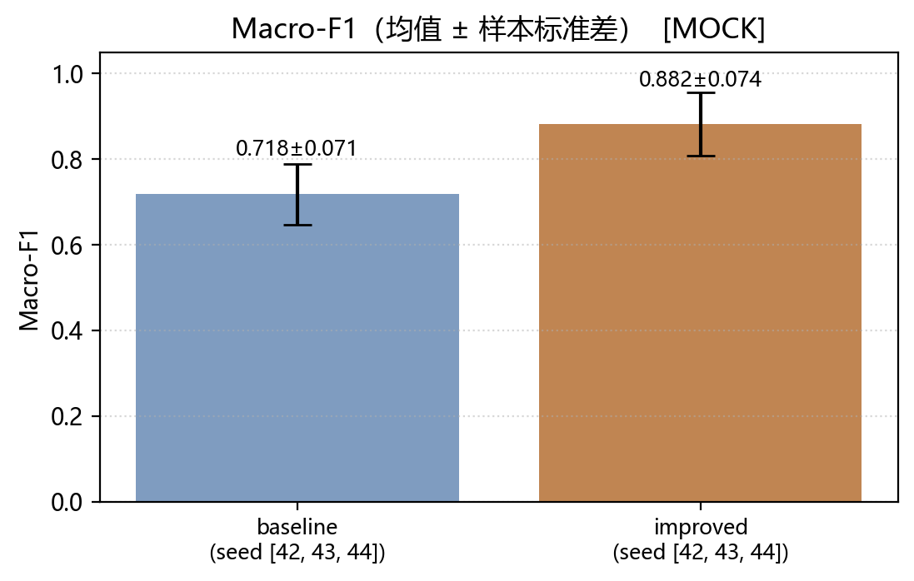

# P4 统一评测与复现

负责人：待认领（分支 `part/p4-evaluation`）。本节对应的代码与产物见
`src/evaluation/`、`configs/evaluation/default.json`、`tests/p4/`、
`reports/figures/P4/`。

## 1. 评测口径

小组统一主指标为 **Macro-F1**，固定对 0（无偏见）与 1（有偏见）两类等权平均，
避免正类只占约 16% 时 Accuracy 虚高。同时报告正类 Precision/Recall/F1、
负类 F1、Accuracy 与混淆矩阵，混淆矩阵行是真值 0/1、列是预测 0/1，即
`[[TN, FP], [FN, TP]]`。precision/recall/F1 的分母为 0 时按 0 处理，
并在 `metrics.json` 中保留原始浮点数，展示时才四舍五入。

二分类标签由 `label = int(score >= threshold)` 得到，阈值从 run 元信息读取，
评测器不调阈值；因此"分数变了但标签没变"或"事后换阈值"都会在契约检查阶段被拒绝。

## 2. 为什么核对 ID 而不是只对行数

官方数据按类别拼接，ID 与行号本身携带类别信息。只比较行数会漏掉三类问题：
预测文件被重排后与金标错位、某条样本重复而另一条缺失（行数仍然相等）、
以及拿 dev 的预测去对 test 的金标。因此评测器逐行比对
`predictions.jsonl` 与 `labels/<split>.jsonl` 的 ID 顺序，任何不一致都返回
退出码 2，并打印出错行号与两个 ID。

## 3. 契约检查清单

| 检查项 | 失败表现 | 处理 |
|---|---|---|
| manifest 必需字段与 schema_version | 缺字段、版本不支持 | 退出码 2 |
| manifest 登记的 SHA256 / 行数 | 数据被改动、文件被截断 | 退出码 2 |
| 预测行数、ID 顺序、重复 ID | 缺行、乱序、重复 | 退出码 2，指出行号 |
| label 类型 | 出现 `true/false` 或 0/1 以外取值 | 退出码 2 |
| score 合法性 | NaN、Inf、越界 | 退出码 2 |
| 阈值一致性 | `label != int(score >= threshold)` | 退出码 2 |
| mock 标记一致性 | run 与 manifest 的 `is_mock` 不同 | 退出码 2 |
| 数据版本一致性 | `dataset_manifest_sha256` 不匹配 | 退出码 2 |
| 跨 run 可比性 | 不同 data hash / split / 真实与 mock 混用 | 退出码 2 |

测试用手算小例子、被篡改的预测文件和 mock run 覆盖了上述全部分支，
共 21 个用例，`python -m unittest discover -s tests -v` 全部通过。

## 4. 结果表（MOCK，仅验证流程）

以下数值来自内置 fixtures（合成数据、2 方法 × 3 seed、test 60 条），
**不是模型结论**，只用于验证"评测—汇总—出表"链路。真实 run 到齐后，
用同一条命令替换 `--data-dir` 与 `--run-dirs` 即可得到正式主表。

| method | seed | n | Accuracy | Macro-F1 | P(1) | R(1) | F1(1) | F1(0) |
|---|---:|---:|---:|---:|---:|---:|---:|---:|
| baseline | 42 | 60 | 0.7333 | 0.7306 | 0.6944 | 0.8333 | 0.7576 | 0.7037 |
| baseline | 43 | 60 | 0.6500 | 0.6419 | 0.6154 | 0.8000 | 0.6957 | 0.5882 |
| baseline | 44 | 60 | 0.7833 | 0.7818 | 0.7429 | 0.8667 | 0.8000 | 0.7636 |
| improved | 42 | 60 | 0.8500 | 0.8496 | 0.8182 | 0.9000 | 0.8571 | 0.8421 |
| improved | 43 | 60 | 0.8333 | 0.8303 | 0.7632 | 0.9667 | 0.8529 | 0.8077 |
| improved | 44 | 60 | 0.9667 | 0.9667 | 0.9667 | 0.9667 | 0.9667 | 0.9667 |

多种子汇总（均值 ± 样本标准差）：

| method | runs | Macro-F1 | Accuracy | P(1) | R(1) |
|---|---:|---|---|---|---|
| baseline | 3 | 0.7181 ± 0.0708 | 0.7222 ± 0.0674 | 0.6842 ± 0.0643 | 0.8333 ± 0.0333 |
| improved | 3 | 0.8822 ± 0.0738 | 0.8833 ± 0.0726 | 0.8493 ± 0.1053 | 0.9444 ± 0.0385 |

图 P4-1　Macro-F1 的均值与样本标准差（mock 数据，标题已标注 MOCK）

从 mock 数据可以看到两点与真实实验一致的规律：一是同一方法不同种子的波动
（baseline 的 Macro-F1 从 0.6419 到 0.7818），说明只报单次结果不可靠；
二是正类召回普遍高于正类精确率，模型倾向于把中性文本判成有偏见，
这提示后续需要结合 P5 的错误分析看假阳性集中在哪些表达上。

## 5. 复现记录

每次 `compare` 都会写出：

- `environment.json`：Python 版本、操作系统与 CPU、工作目录、完整命令行、
  git commit、数据 manifest 的 SHA256；
- `reproduction.json`：命令、数据包路径与 hash、每个 run 的预测文件 SHA256、
  产物清单；
- 每个 run 目录下的 `metrics.json`：含 `predictions_sha256` 与
  `dataset_manifest_sha256`，任何一张表都能追溯到原始文件。

复现步骤（换目录或干净环境）：安装 `requirements/p4.txt` → 用同一
`--data-dir` 与同一批 `--run-dirs` 执行 `compare` → 对比
`comparison.csv` 各列是否逐字节一致、`environment.json` 的 python 版本是否一致。

## 6. 局限

1. 当前主表数值全部来自合成 fixtures，只能证明流程正确，不能替代真实实验；
2. 评测器不参与阈值调优，只校验阈值一致性；若后续做 valid 网格调参，
   需把选中的阈值写回 run 元信息并重新评测；
3. 分组指标（男/女/其他/不明确）与挑战集由 P5 负责，本模块不重复实现；
4. 仅按 ID 与文本做一致性检查，不做语义层面的近重复判定。

## 7. 答辩要点

**Macro-F1 与正类 F1 的差别？** 正类 F1 只关心"有偏见"这一类，负类大量样本
判错也不会明显拉低它；Macro-F1 对两类等权平均，正类样本少，任何一类的
退化都会被放大，因此更适合类别不平衡的偏见检测任务。数据中正类约占 16%，
只用 Accuracy 会让"全判无偏见"的模型拿到 84% 的假高分。

**为什么要核对 ID 而不是只对行数？** 行数相等不代表内容对齐：预测文件可能
被重排、某条重复而另一条缺失，或者拿 dev 的预测去对 test 的金标。逐行核对
ID 顺序能同时发现错位、缺失、重复与 split 混用四类问题。

**怎样避免测试调参？** 阈值和 checkpoint 只在 valid 上选，冻结后写入
`run_metadata.json`；评测器只读取该阈值并校验 `label` 与分数一致，
test 上的任何改动都会导致契约检查失败，从流程上堵住"看 test 结果再调"。
