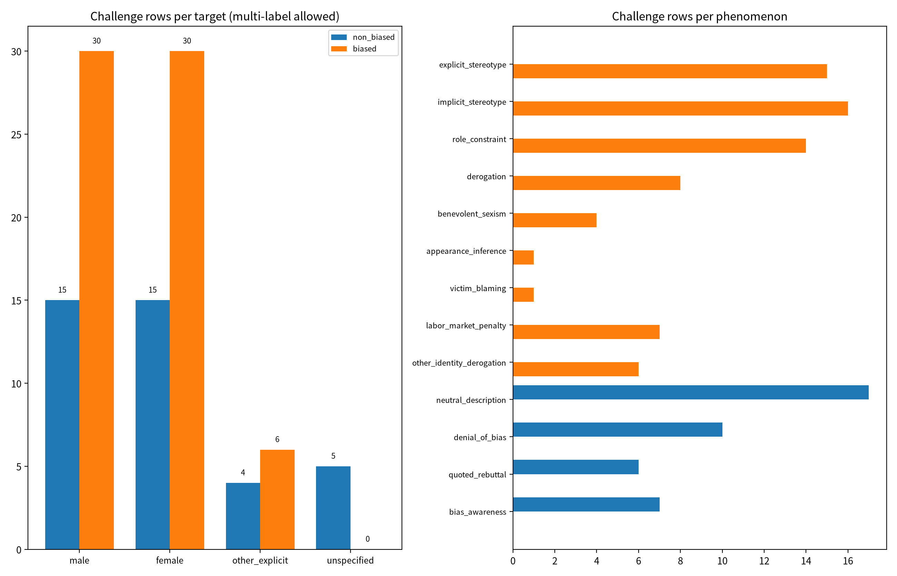
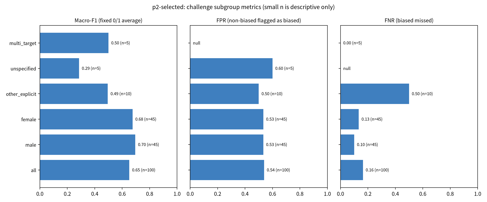

# P5 多性别对象挑战集与错误分析

负责人：刘玉麒（202315060318），分支 `part/p5-fairness`。本节只使用冻结的挑战集与预测文件，不修改 P4 的官方 test 主表。

## 1. 任务解释与分析边界

检测对象是**文本中的性别偏见**：针对男性、女性及其他性别身份的刻板印象、角色限制与差别对待。判定依据是上下文是否表达刻板化、贬损或差别待遇，**出现“男/女/他/她”本身不是偏见**。因此挑战集刻意包含三类容易误判的负例：中性描述（“她是一名卡车司机”）、否定刻板说法（“丈夫承担家务并不丢人”）、引用后反驳（“他说‘女人不适合当领导’，我当场反驳了”）。

分组只按**句中被指向的对象**（人工标注，可多标签），不按作者性别；代词频率只用于挑候选，不能当真实群体标签。挑战集与官方 test 完全分开：不参与训练、阈值选择或 checkpoint 选择。

## 2. 挑战集构成

`data/challenge/p5-gender-challenge-v1`，100 条，manifest SHA256 `af3bbb17…d9dd5f3f3`，冻结于 2026-11-20 22:25（在查看任何模型输出之前封存）。

| 对象组 | 条数 | 有偏见 | 无偏见 |
|---|---:|---:|---:|
| male | 45 | 30 | 15 |
| female | 45 | 30 | 15 |
| other_explicit（跨性别/非二元） | 10 | 6 | 4 |
| unspecified（对象不明确） | 5 | 0 | 5 |
| multi_target（同时指向男女） | 5 | 5 | 0 |

标注现象（多标签）覆盖 13 类，主要分布：中性描述 17、隐性刻板印象 16、显性刻板印象 15、角色限制 14、否定偏见 10、贬损 8、偏见现象讨论 7、职场差别对待 7、引用并反驳 6、其他身份贬损 6、善意性别歧视 4，外貌推断与受害者归责各 1。总正类 61 / 负类 39。

设计取舍：正类比例 61% 是刻意平衡，**不代表真实语料的偏见率**；`unspecified` 没有正例，跨性别组仅 10 条，这两组只能作描述性分析。



## 3. 标注流程与复核状态（未完成项）

流程：先写判定规范与现象词表 → 按对象采样 → 标注标签、对象、现象 → 封印 manifest → 才允许模型打分。标签（`challenge_labels.jsonl`）与对象/现象（`challenge_annotations.jsonl`）分开保存，训练与打分接口都不读标注文件。

**当前是单标注者草案（`review_status=single_annotator_draft`）**：`reviewers` 字段为空，双人独立复核、分歧裁决与 kappa 尚未完成。仓库已提供复核工具：

```sh
python -m src.fairness review --first annotation-a/ --second annotation-b/ --output runs/p5/review.json
```

它输出标签一致率、Cohen's kappa、对象/现象集合的精确一致率与 Jaccard 均值，并逐条列出分歧。**在第二位组员独立标注并完成裁决之前，本节的任何分组数字都只能作为流程与错误模式的证据，不能称为“人工复核基准上的结论”。**

为让这一步可执行，已按本指南导出一份**盲评表**（只含 id 与句子，不含金标与模型分数）连同汇总脚本交给第二位同学：填完后用脚本生成第二标注目录，再跑上面的 `review` 命令即可得到 kappa 与逐条分歧，由本人统一裁决并回填本节。

## 4. 分析口径

- 只读预测文件，不加载模型内部；`score` 命令只通过公开 adapter 打分，阈值取模型元信息（本次两个模型均为 0.5），challenge 上不做任何调参。
- 每组都报 `n / positive_n / negative_n` 与混淆矩阵四格；`FPR = FP/(FP+TN)`、`FNR = FN/(FN+TP)` 分母为 0 时写 `null`，不填 0。
- `macro_f1` 按项目主指标固定对 0/1 两类平均（缺类按 0）；单极性子组另报 `macro_f1_defined_classes`，避免把“只有正类”的子组读出虚假低分。
- 多标签：一条句子可同时进入 male 与 female 组，所以各对象组 n 之和大于 100。
- 小分组阈值：对象组 n<20、现象组 n<10 在 `warnings` 中点名，不作稳定估计。

## 5. 真实结果（P2 字符 TF-IDF + LR）

对照模型：`p2-selected`（char 1-gram，C=0.5，balanced，seed 42）与 `p2-char1-3gram`（char 1–3 gram，C=1.0，balanced，seed 42）。二者都是 P2 基线族，**不是“基线 vs 改进”**；P3 改进模型尚未产出预测。

| 对象组 | n（正/负） | Macro-F1 | 有偏见类 P / R | FPR | FNR |
|---|---:|---:|---:|---:|---:|
| all | 100（61/39） | 0.652 | 0.708 / 0.836 | **0.538** | 0.164 |
| male | 45（30/15） | 0.695 | 0.771 / 0.900 | 0.533 | 0.100 |
| female | 45（30/15） | 0.675 | 0.765 / 0.867 | 0.533 | 0.133 |
| other_explicit | 10（6/4） | 0.495 | 0.600 / 0.500 | 0.500 | 0.500 |
| unspecified | 5（0/5） | 0.286（defined 0.571） | – | 0.600 | null |
| multi_target | 5（5/0） | 0.500（defined 1.000） | 1.000 / 1.000 | null | 0.000 |

第二模型（1–3 gram）总体 Macro-F1 0.657、FPR 0.462、FNR 0.230；女性组 F1 升到 0.709，但漏检增多（FNR 0.233），男性组几乎不变。这说明在当前样本上换 n-gram 配置**没有解决**“靠词面触发”的问题，而不是一次可宣布的提升。



**三个可直接讲的结论：**

1. **主要错误是假阳性，不是漏检。** 总体 FPR 53.8%，远高于 FNR 16.4%：39 条无偏见句里有 21 条被判成有偏见。模型看到性别词就倾向判 1，与官方 dev 上 0.755 的 Macro-F1 相比，挑战集掉到 0.652。
2. **否定、引用反驳和“讨论偏见”几乎失效。** 按现象分组：`bias_awareness` FPR 85.7%（7 条中 6 条误判）、`neutral_description` 41.2%、`denial_of_bias` 50%、`quoted_rebuttal` 50%。这正是“性别词 ≠ 偏见”的失败点。
3. **男性偏见没有被系统性忽略，但跨性别身份被明显漏检。** male 与 female 的 Macro-F1 为 0.695 / 0.675，男性 FNR 反而更低（0.100 vs 0.133），说明这份数据里“只关注女性”的担心不成立；`other_explicit` FNR 50%、F1 0.495，跨性别相关表达基本落在字符词表之外。

## 6. 错误与成功案例（节选，完整 20 条见 `runs/p5/report/error_cases.jsonl`）

每个案例都带两个模型的 label/score 与人工解释，以下 12 条为摘录（score 为主模型 `p2-selected`）：

| id | 类型 | 句子 | 金标/分数 | 解释要点 |
|---|---|---|---|---|
| p5-021 | 假阴性 | 大老爷们儿还计较这点小事，不像话。 | 1 / 0.15 | “大老爷们儿”＋“不像话”构成角色规范，但口语称谓在训练词表稀疏，信号弱 |
| p5-082 | 假阴性 | 跨性别者心理都有问题，最好别打交道。 | 1 / 0.21 | 明显污名化，但“跨性别”属词表外身份词，只捕到“心理/问题” |
| p5-086 | 假阴性 | 非二元性别只是跟风赶时髦，过两年就消停了。 | 1 / 0.22 | 身份贬低＋隐性刻板印象，模型只看到“跟风/时髦” |
| p5-018 | 假阴性 | 他长得文文弱弱，做事肯定靠不住。 | 1 / 0.25 | 外貌推断能力，缺少“文弱→不可靠”组合特征 |
| p5-012 | 假阴性 | 老公在家带娃做饭，说出去多没面子。 | 1 / 0.35 | 男性角色限制＋社会羞耻，但没有“男人就该”模板 |
| p5-097 | 假阳性 | 男性和女性的差异常被过度强调。 | 0 / 0.97 | 性别词高度重合，单字特征读不出“被过度强调”的批判语气 |
| p5-090 | 假阳性 | 不管男女还是非二元，能力才是标准。 | 0 / 0.97 | 让步结构＋反偏见主张，模型无句法表示 |
| p5-078 | 假阳性 | 她是两个孩子的妈妈，也是公司的合伙人。 | 0 / 0.97 | “妈妈”绑定家庭角色，“合伙人”的反证据未被利用 |
| p5-096 | 假阳性 | 这个社会对男女的要求不一样，但不该如此。 | 0 / 0.95 | 前半句像角色限制句，转折否定没有被编码 |
| p5-074 | 假阳性 | 别拿“贤惠”要求所有女人。 | 0 / 0.92 | “贤惠”“所有女人”词面重合，祈使否定“别拿”无特征 |
| p5-061 | 真阳性 | 女人要温柔贤惠，太能干了男人不喜欢。 | 1 / 0.998 | 与训练集善意性别歧视模板高度重合，正确 |
| p5-038 | 真阴性 | 这位父亲每天接送孩子，邻居早就习以为常。 | 0 / 0.118 | 无评价性性别词，低分放过正确 |

案例反映的机制一致：**字符 n-gram 只能匹配词面，不能表示否定、转折、引用与批判语气；词表外的身份词（跨性别、非二元）既导致漏检，也因只在偏见语境出现而放大假阳性。** 这不是“模型有性别偏见”的结论，而是特征表达能力与训练覆盖的结论。

## 7. 局限

1. **单标注者**：标签与对象/现象均由一人拟定，缺少第二人独立复核和裁决记录；复核工具已就绪，kappa 待补。
2. **样本量与结构**：100 条、61% 正类，是接口与小样本分析集，不能估计总体偏见率；`other_explicit` 10 条、`unspecified` 5 条且无正例，分组指标只能描述。
3. **模型对照不足**：P3 改进模型尚未产出，当前第二条曲线是 P2 的特征消融，不能写成“改进未提升”。P3 到达后只需增加一条 `--prediction` 重跑。
4. **阈值**：沿用模型元信息 0.5，未在 challenge 上调阈值；因此 FPR 高有一部分来自未校准的决策边界，报告不作阈值优化后的成绩。
5. **挑战集来源**：自建、非官方 held-out，不能与官方 test 指标同表比较。

## 8. 复现

```sh
python -m src.fairness build --output-dir data/challenge/p5-gender-challenge-v1
python -m src.fairness score --component baseline --model-dir runs/p5/model-p2-s42 \
    --name p2-selected --output-dir runs/p5/challenge-p2-selected
python -m src.fairness report \
    --prediction p2-selected=runs/p5/challenge-p2-selected \
    --prediction p2-char1-3gram=runs/p5/challenge-p2-char1-3gram \
    --output-dir runs/p5/report --figures-dir reports/figures/P5 \
    --case-notes configs/fairness/case_notes.json
python -m unittest tests.p5.test_fairness -v
```

验收记录（挑战集 hash、两个 run 的预测 hash、分组指标与缺口）在 `configs/fairness/acceptance.json`。

## 9. 答辩三问

- **男性也会遇到哪些性别偏见？** 角色限制（“男人就得养家”“不许哭”）、情感压抑、外貌气质羞辱（“娘里娘气”）、育儿与护理职业的污名、以及“让着女人”这类善意性别歧视。他们不是“不会被偏见”的群体。
- **为什么性别词不等于偏见？** 偏见在语义层：是否把性别与能力、角色、价值绑定，是否贬损或差别对待。中性描述、否定刻板说法、引用后反驳都不构成偏见；字符词面无法区分这三类，正是本次 FPR 53.8% 的来源。
- **少量分组能支持怎样的结论？** 能定位错误模式与覆盖缺口（如跨性别组 FNR 50%、bias_awareness 组 FPR 85.7%），不能给出总体人群的公平性估计；样本不足时必须报 n、写 null、标“描述性”。

## 10. 贡献记录

| 姓名 | 学号 | 角色 | 负责范围 |
|---|---|---|---|
| 刘玉麒 | 202315060318 | P5 负责人 | 挑战集构建与冻结、分组指标与错误分析、报告片段与图表、复核流程 |

本人实际产出：

- **挑战集**：`data/challenge/p5-gender-challenge-v1` 100 条（男性对象 45、女性对象 45、跨性别/非二元 10、多目标 5、不明确 5；正 61 / 负 39），含 `challenge.jsonl`、`challenge_labels.jsonl`、`challenge_annotations.jsonl` 与封印 manifest（SHA256 `af3bbb17…d9dd5f3f3`），在查看任何模型输出之前冻结。
- **代码**（`src/fairness/`）：`build`（规范先行的采样与封印）、`data`（schema 校验与防篡改）、`metrics`（分组 FPR/FNR/Macro-F1，零分母记 null）、`cases`（错误案例抽取）、`figures`（两张图）、`cli`（`build/seal/score/report/review`），共 14 项单测（`tests/p5/`）。
- **真实结果**：用 P2 两个特征配置在挑战集上打分（`is_mock=false`，预测文件带 SHA256），总体 Macro-F1 0.652 / FPR 53.8% / FNR 16.4%，全部登记在 `configs/fairness/acceptance.json`。
- **分析**：`reports/sections/P5.md` 与 `reports/figures/P5/*.png`；20 条带人工解释的错误/成功案例（`runs/p5/report/error_cases.jsonl`，另附 `configs/fairness/case_notes.json`）。
- **复核流程**：实现 `review` 子命令（标签一致率、Cohen's kappa、对象/现象集合精确一致率与 Jaccard、逐条分歧），并导出盲评表与汇总脚本供第二位同学独立标注。
- **协作**：PR #20（已合并到 `main`）；认领与回归证据见 Issue #5、#21。

## 11. 3 分钟讲解提纲

| 时间 | 内容 | 展示 |
|---|---|---|
| 0:00–0:25 | 任务与边界：检测的是文本中的性别偏见，不是作者身份；“男/女”出现本身不是偏见 | 第 1 节首段 |
| 0:25–1:10 | 挑战集怎么来：先规范后采样、对象与现象分开、看模型输出前封印 100 条与 manifest | 第 2 节表格 + `challenge_composition.png` |
| 1:10–2:10 | 真实结果：FPR 53.8% 远高于 FNR 16.4%；否定/引用反驳/讨论类几乎失效；男性组未被系统性忽略、跨性别组漏检 50% | 第 5 节表格 + `target_metrics.png` + 3 条案例 |
| 2:10–2:40 | 机制与局限：字符 n-gram 读不出否定与转折；单标注者草案、61% 正类为刻意平衡、小样本只作描述；P3 预测未接入 | 第 7 节 |
| 2:40–3:00 | 复现：`build → score → report` 三条命令 + 单测 14 项；换模型只需加一条 `--prediction` | 第 8 节 |

讲的时候按“**结论先行**”：一句话说清挑战集暴露的是**词面触发**而非性别立场，再用 FPR 与三个现象组的数据兑现这句话。
